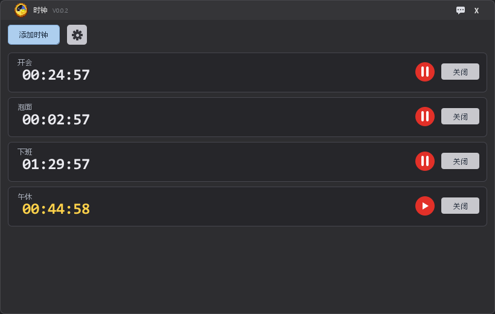

# Clock 时钟



一个自己写的 Windows 桌面倒计时小工具。免费、开源、单文件免安装。


## 功能

- **添加倒计时**：天 / 时 / 分 / 秒随便填，可以给倒计时起名字
- **到点提醒**：播放提示音 + Windows 右下角系统通知
- **暂停 / 继续**：中途有事点一下就暂停，剩余时间保留
- **超时显示**：到点后继续往上计时，显示"已超时 00:12:34"
- **常驻托盘**：点 X 只是收进托盘，右键菜单可显示或退出
- **深色界面**：圆角窗口、淡入淡出、卡片滑入动画
- **提示音切换**：内置两种提示音，设置会记住

## 下载

在 [Releases](https://github.com/zoozofgx/Clock/releases) 页面下载 `Clock.exe`，或者直接下载仓库根目录里的 `Clock V0.0.2.exe`。

**不需要安装 Java**，程序自带运行环境。

## 使用

1. 双击 `Clock.exe`
2. 点「添加时钟」，填好时间，点「添加」
3. 倒计时结束会响铃并弹通知

第一次运行会在 exe 旁边生成配置文件：

```
Clock.exe
config/
    settings.ini      ← 你的设置
```

`settings.ini` 内容示例：

```ini
# soundChoice: 0 = 新世界, 1 = universfield
soundChoice=0
```

## 从源码构建

需要 JDK 21 或更高版本。

```bat
cd Clock
build.bat
启动.vbs
```

源码结构：

```
Clock/
    src/clock/
        Main.java            程序入口
        MainWindow.java      主窗口
        CountdownCard.java   倒计时卡片
        AddDialog.java       添加弹窗
        SettingsDialog.java  设置面板
        AnnounceDialog.java  公告窗口
        AboutDialog.java     关于作者
        ConfirmDialog.java   退出确认
        AppInfo.java         版本号 / 公告 / 作者信息
        AppConfig.java       资源路径 / 提示音 / 端口
        Settings.java        配置文件读写
        SoundPlayer.java     音效播放
        Assets.java          资源查找
        UiKit.java           界面工具
    assets/
        images/              图标
        sounds/              提示音
```

## 说明

- 只支持 **Windows**
- 单实例运行：重复启动只会把已有窗口叫到前面
- 不写注册表、不建快捷方式、不联网（除了点作者链接会打开浏览器）

## 关于音效

`assets/sounds` 下的音频仅用于演示和体验，**版权归原作者所有**，请勿用于商业用途。
如果你要二次分发，请自行替换成可商用素材。

## 作者

- 作者：迷离の兽兽
- GitHub：https://github.com/zoozofgx
- B 站：https://space.bilibili.com/668736520
- QQ 群：435382898
- 辅助：DeepSeek
- 文案编写：DeepSeek

## 许可

代码采用 [MIT](LICENSE) 协议开源。

## 更新日志

历次版本改动详见 [CHANGELOG.md](CHANGELOG.md)。
